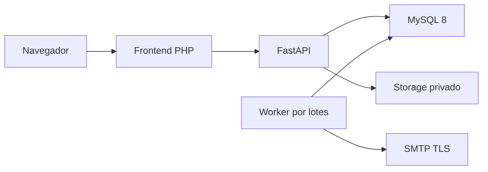

# Documento técnico

Sistema de Trazabilidad Documental para Auditorías. Samuel Cruz Barrientos, Ingeniería en Sistemas, Tecnológico de Estudios Superiores de Cuautitlán Izcalli / TecNM. PluriOne S.A. de C.V. / Develop Talent & Technology. Residencia: septiembre de 2026 a enero de 2027. Asesor empresarial: Juan Méndez Herrera. Líder/evaluador: Edgar Loheffelmman.

## 1. Contexto y diseño construido

El sistema reúne metadatos y archivos que sustentan auditorías. Separa presentación, autorización/reglas, persistencia y almacenamiento para mantener decisiones atribuibles y conservar versiones históricas. Este documento explica el diseño implementado; los procedimientos operativos se encuentran en el Manual técnico.

## 2. Arquitectura y componentes

```text
Navegador: cookie PHP, formularios, HTML/CSS/JS
  -> PHP: sesión privada, CSRF, validación de presentación, cliente HTTP
     -> FastAPI: autenticación, permisos y scopes, routers/schema/services
        -> SQLAlchemy/PyMySQL -> MySQL 8/InnoDB
        -> StorageService -> filesystem privado con SHA-256
Procesador de correo Python -> AuthMailJob -> SMTP TLS
```



El esquema textual anterior es la representación portable para PDF/DOCX. No se depende de renderizar Mermaid para comprender el diseño. PHP no contiene acceso SQL ni SMTP; el worker es separado del request HTTP.

## 3. Backend

Python 3.14 con FastAPI y Uvicorn. Diez routers agrupan documentos, evidencias, catálogos, auditorías, hallazgos, aprobaciones, dashboard, análisis, auth y acceso/recuperación. El baseline contiene 61 operaciones HTTP contando estado raíz. Pydantic valida contratos; SQLAlchemy 2 representa entidades; PyMySQL conecta al motor real. Se mantiene `app.main:app` como entrada de ejecución.

Los servicios contienen reglas y transacciones; routers resuelven dependencias y contratos HTTP. Se usan consultas parametrizadas y scopes SQL. Errores internos, de drivers y autenticación se sanitizan antes de responder. OpenAPI ofrece contrato técnico local. El [inventario](INVENTARIO_IMPLEMENTACION.md) enumera endpoints/tablas reales.

## 4. Frontend

PHP 8.1+ con cURL, mbstring y fileinfo; HTML/CSS/JavaScript sin framework SPA. Un router `index.php?pagina=...` permite sólo páginas conocidas. Includes comparten navegación, sesiones y helpers; services centralizan llamadas API, traducción de errores y controladores; pages presentan formularios y datos escapados.

La sesión almacena el JWT en servidor y usa cookie HttpOnly/SameSite. Cada petición protegida valida `/auth/me`. Los formularios mutativos utilizan POST y CSRF; después del éxito aplican redirección para evitar repetir envíos. Descargas pasan por PHP mediante un temporal y streaming, sin exponer storage ni cargar todo el archivo en memoria. La navegación reduce controles según rol, pero FastAPI conserva la autoridad final.

## 5. Persistencia y modelo

MySQL 8/InnoDB, utf8mb4 y timestamps UTC en DATETIME(6). SQLAlchemy comparte metadata con Alembic. Hay 18 tablas de aplicación y `alembic_version`. Revisiones: 001 dominio; 002 sesiones; 003 límites/login e índices; 004 solicitudes/tokens/cola; 005 estado IN_REVIEW de auditoría. Fase 9 no requiere 006.

```text
Usuario -> Auditoría (responsable/creador)
Área -> Documento -> VersionDocumento
Auditoría <-> DocumentoAuditoria <-> versión exacta
Auditoría -> Evidencia / Hallazgo -> HallazgoEvidencia
VersionDocumento -> RondaAprobacion -> DecisionAprobacion -> Usuario aprobador
Usuario -> AuthSession / tokens / trabajos de correo
EventoAuditoria -> actor + entidad + acción + datos + timestamp
```

Las FK `RESTRICT`, UNIQUE y CHECK delimitan referencias, números, enums y estados terminales. El vínculo documental contiene versión concreta y su documento; no basta unir un ID de versión a cualquier cabecera. El actor histórico se conserva. ADMIN no equivale a eliminación libre de usuarios con dependencias.

## 6. Almacenamiento y versiones

Storage privado fijo en `storage/` de cada instalación, particionado por categoría/año/mes y nombre UUID. Se valida nombre/key, separadores, longitud Win32 UTF-16, rutas codificadas y enlaces/symlinks/junctions. La escritura usa un temporal exclusivo, SHA-256 en bloques y publicación sin sobrescritura mediante hardlink. Metadatos: key, nombre original saneado, MIME, bytes, hash, autor y fecha.

El cliente carga bytes y comentario; no fija hash/storage key. Cada versión se preserva y la cabecera puede señalar la vigente. No hay operaciones API para editar/eliminar versiones históricas ni cambiar su SHA-256. Esto protege el contrato de aplicación, sin afirmar inmutabilidad física frente a un administrador externo con permisos de disco/SQL.

DB y filesystem no son una transacción distribuida. Antes de COMMIT se compensa sólo un archivo nuevo no confirmado. Si el resultado de COMMIT es desconocido se conserva el archivo y devuelve `COMMIT_OUTCOME_UNKNOWN`/503; no se reintenta ni borra a ciegas. Una caída abrupta puede dejar un huérfano y exige reconciliación read-only.

## 7. Autenticación y autorización

Argon2id hashea passwords; JWT admite HS256/384/512 con secreto privado válido, expiración de 15 minutos y `sid` persistido. No hay refresh token. Autenticación valida firma/claims, sesión vigente no revocada, usuario activo y rol canónico actualizado. Logout revoca esa sesión. El rol no se toma del payload del cliente.

RBAC deniega por defecto. ADMIN ve globalmente; auditores ven sus auditorías y documentos vinculados; RESPONSABLE_AREA ve documentos propios; APROBADOR ve versiones asignadas. Scope precede a paginación, agregaciones y comparaciones de hashes. El actor de mutación proviene de autenticación, incluidos parámetros legacy de upload que no conceden suplantación. [Matriz detallada](MATRIZ_PERMISOS.md).

ADMIN gestiona recursos y solicitudes existentes sin reescribir eventos/hashes ni decidir en nombre del APROBADOR. El servicio de decisión exige explícitamente APROBADOR activo asignado. Catálogos son lectura; no existe CRUD HTTP general de usuarios/áreas.

## 8. Auditorías, evidencias y hallazgos

Auditoría usa responsable auditor elegible y ciclo `PLANNED → IN_PROGRESS → IN_REVIEW → COMPLETED`, con retorno de revisión a progreso. Sólo ADMIN edita/avanza el ciclo actual. DDL también admite CANCELLED para datos existentes; el router no ofrece esa transición. Cierre valida requisitos del expediente; estados terminales bloquean cargas/acciones relacionadas según reglas del servicio.

Evidencias FILE, REFERENCE, NOTE y OTHER pertenecen a auditoría autorizada; vínculos a documento/versión deben ser coherentes. Hallazgos usan severidad LOW/MEDIUM/HIGH/CRITICAL y estados OPEN, IN_PROGRESS, PENDING_VERIFICATION, CLOSED o ACCEPTED_RISK. Resolución, responsable y fechas sustentan cierre/verificación. Sólo ADMIN/AUDITOR_INTERNO gestionan hallazgos autorizados. RESPONSABLE_AREA no accede a este módulo pese a su nombre de rol.

## 9. Aprobaciones

Una ronda se refiere a versión exacta. ADMIN/AUDITOR_INTERNO autorizado crea asignaciones de APROBADOR activo. Sólo una ronda activa por versión; numeración serializada. `PENDING → IN_REVIEW`; cada asignado decide una vez. Cuando todas las decisiones están resueltas se deriva resultado con precedencia REJECTED, CHANGES_REQUESTED, APPROVED. Cancelación/finalización explícita respetan estado y precondiciones. No se permite cambiar una decisión ya resuelta o una ronda terminal.

## 10. Eventos y trazabilidad

Cada mutación de dominio registra actor autenticado, entidad, acción, timestamps y datos relevantes dentro de la transacción. Historial y actividad se leen bajo permisos. Se exponen whitelists de metadatos para no filtrar otros contextos. No hay endpoint de edición/borrado de eventos. Los eventos del seed se identifican como origen sintético explícito, no se presentan como acciones de usuarios reales.

## 11. Dashboard y análisis documental

Dashboard 7D ofrece resumen, indicadores, alertas y actividad; usa aggregate SQL tras scope. Ratios sin datos conservan null/NO_DATA. Un error de API produce indisponibilidad visible, sin fabricar ceros. Las alertas son derivadas de estado al consultar, distintas del correo de autenticación.

7E es un motor determinista explicable. Aplica reglas sobre ausencia/inconsistencia de versiones, metadatos, hash/duplicados visibles y estados. La similitud de nombres usa normalización Unicode y `SequenceMatcher`, con umbral configurable 0.92; no lee contenido semántico ni utiliza Ollama, IA generativa, ML/LLM o modelos entrenados. La consulta local limita 64 candidatos y 100 versiones, con nombre mínimo de ocho caracteres para similitud. El chequeo local de storage es read-only y acotado; informa comprobación completa/truncación. No garantiza detectar cualquier irregularidad ni todos los documentos faltantes; sólo comprueba las condiciones y referencias conocidas dentro del alcance. No equivale a escaneo antivirus ni certificación documental.

El análisis libera la conexión del snapshot antes de una barrera fresca de autorización para no responder con alcance revocado. Los detalles y reglas se conservan en [Fase 7E](FASE_7E_ANALISIS_INTELIGENTE.md).

## 12. Seguridad y concurrencia

Presupuestos globales por proceso y buckets MySQL por identificador limitan login; Argon2 tiene admisión y concurrencia acotadas. Recuperación/acceso tienen límites separados y respuestas genéricas. Turnstile opcional añade challenge adaptativo; disabled conserva límites locales. Password reset usa 32 bytes aleatorios, SHA-256 persistido, propósito, expiración, fingerprint y single-use; cambio revoca sesiones. SMTP TLS se ejecuta fuera de transacciones de request.

Bloqueos de filas y orden definido serializan cambios de ownership, estados, rondas y tokens. Precondiciones de timestamp/estado producen 409 al cambiar el recurso. Límites streaming default de 20 MiB y cuerpos JSON de 1 MiB protegen recepción; multipart admite margen de 128 KiB. DB admission respeta capacidad del pool antes de ocupar trabajo síncrono; análisis global admite hasta dos consultas simultáneas por proceso para reducir contención. Un proceso API es requisito del presupuesto global.

## 13. Rendimiento y QA

Baseline Fase 8: 1,212 unit, 1,138 MySQL y 312 frontend, todos verdes; 1,937 contratos distintos dentro de 2,662 ejecuciones. Incluye cargas locales hasta 250 concurrentes, seguridad, errores DB/storage, Chrome real y E2E. Bajo concurrencia extrema el análisis global puede tardar alrededor de un minuto en ese entorno; no se interpreta como SLA aceptado universal. Los límites de login causan rechazos deliberados bajo carga.

Fase 9 valida seed, HTTP RBAC, instalación nueva y documentación. No repite el benchmark completo porque no modifica runtime crítico. Los números actuales y la metodología exacta se registran en [Informe Fase 9](FASE_9_CIERRE_ENTREGA.md); el [informe Fase 8](FASE_8_QA_SEGURIDAD_RENDIMIENTO.md) conserva métricas y deprecaciones.

## 14. Decisiones y límites de diseño

MySQL/Alembic evita depender de dumps personales; PHP mantiene sesión/JWT server-side; almacenamiento local permite demostrar integridad sin servicio externo; reglas deterministas permiten explicar detecciones. No hay servicios cloud descartados dentro de la implementación actual. Se conserva deuda de huérfanos, límites 7E y administración general incompleta. El backend de recuperación, tokens/controles, cola, worker y configuración SMTP están construidos, pero el envío real no está disponible en la demo por falta de proveedor externo configurado; las cuentas ficticias no tienen buzón. No se acredita recepción real. La operación productiva, licencia explícita y eventual IA local son decisiones posteriores.
