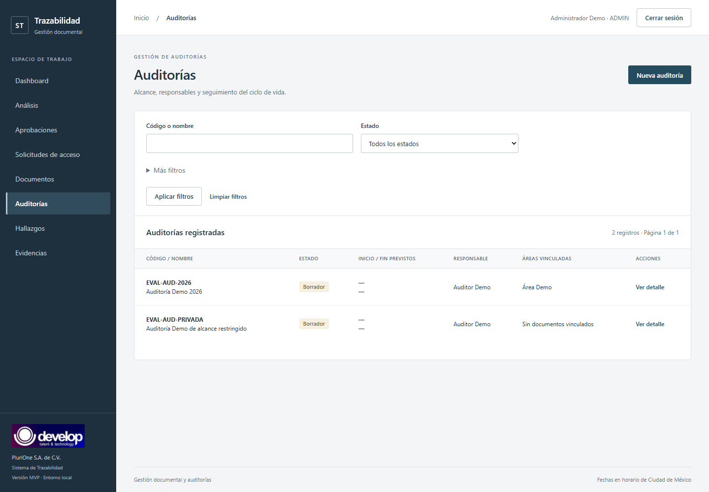
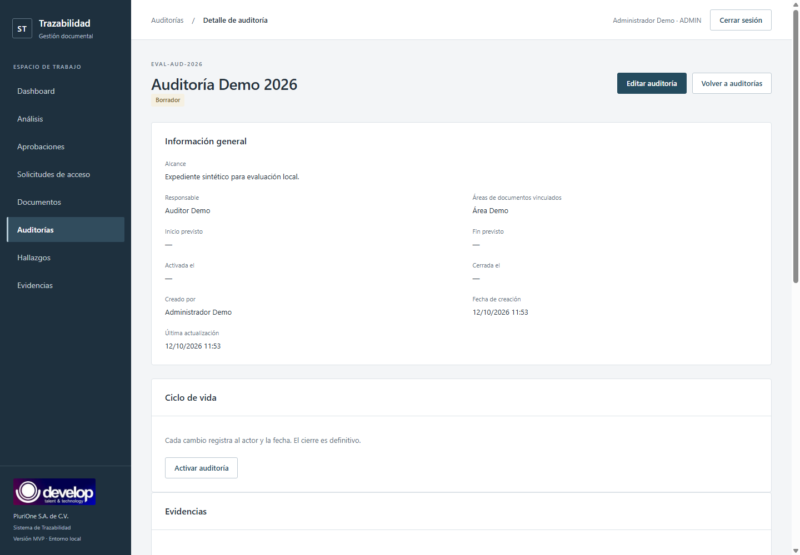
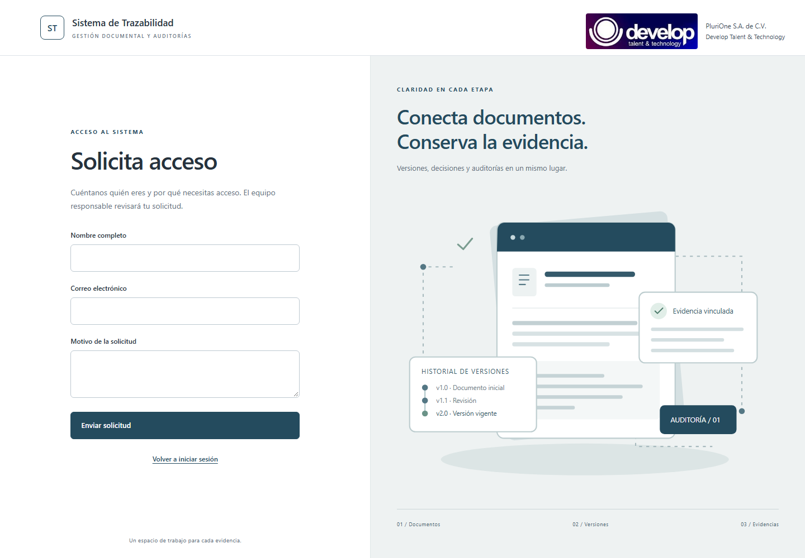

# Evidencia del proyecto

Sistema de Trazabilidad Documental para Auditorías. Samuel Cruz Barrientos, Ingeniería en Sistemas, TESCI / TecNM. Residencia con PluriOne S.A. de C.V. / Develop Talent & Technology. Evidencia de cierre, 9 de octubre de 2026.

## 1. Entorno y metodología

Capturas renovadas el 12 de octubre de 2026 en Fase 9.2 con Chrome real headless a 1440 × 1000, sobre un clone remoto nuevo de baseline `d54a81e` y una copia verificada de los cambios pendientes de release. Se crearon venv, schema y usuario MySQL 8 aislados nuevos, Alembic 005, `.env` temporal desde ejemplo y dataset del seed con el archivo privado de TODO Academy. La identidad de ejecución sólo tiene permiso de su schema. No se usaron usuarios, PDFs, storage ni sesiones de la BD real. También se verificaron login, recuperación, solicitud, dashboard y sidebar a 390 y 320 px; sus capturas complementarias están en `docs/capturas/`.

Las capturas públicas conservan nombres de roles/demo y el TXT sintético. En Fase 9.2 se ocultan los identificadores concretos en el texto del DOM inmediatamente antes de capturar; no se modifica el código de la interfaz ni sus permisos/branding. No se capturan contraseñas. No hay JWT, tokens de reset, `.env`, secretos SMTP/DB ni consola con credenciales. La explicación de cada figura delimita qué demuestra; una imagen no sustituye una prueba de autorización HTTP.

## 2. Acceso

Figura 1: interfaz pública, sin sesión ni rol autenticado, de correo/contraseña con identidad Develop y navegación hacia recuperación y solicitud de acceso. No demuestra por sí sola fortaleza criptográfica; esos contratos se validan con tests.

## 3. Dashboard ADMIN

Figura 2: indicadores y navegación global de la cuenta Administrador Demo. Los valores corresponden al pequeño dataset de evaluación, no a métricas empresariales reales. Los aggregates proceden de FastAPI.

## 4. Auditorías y detalle

Figura 3: dos auditorías sintéticas visibles para ADMIN, con códigos identificables y filtros.

Figura 4: vista ADMIN de la auditoría principal, responsable auditor y expediente demo. El estado inicial planificado permite demostrar el ciclo con permisos administrativos.

## 5. Documento y versiones

Figura 5: vista ADMIN del documento cuyo propietario es Responsable Demo, versión vigente y acciones de carga/descarga. El archivo es un TXT sintético de 67 bytes; sus bytes/hash y descarga se comprobaron por HTTP. Las versiones históricas no se sustituyen por un formulario de edición.

## 6. Hallazgo y evidencia

Figura 6: vista ADMIN de Hallazgo Demo, severidad baja, responsable Auditor Demo y evidencia NOTE relacionada. La relación existe en DB y la consulta llega por API autorizada; no son etiquetas estáticas de una maqueta.

## 7. Aprobación

Figura 7: vista ADMIN de la ronda vinculada a versión exacta, con un aprobador y una decisión pendiente. La validación de Fase 9 inició la ronda como ADMIN, decidió como APROBADOR y rechazó replay y suplantación ADMIN. La nueva imagen conserva el estado inicial reproducible del seed; Fase 9.1 no modifica ese workflow.

## 8. Análisis explicable

Figura 8: listado/resumen ADMIN de reglas sobre documentos autorizados. Un documento sintético sin versión permite observar anomalías sin introducir corrupción. El módulo aplica reglas, hashes, metadatos/versiones y similitud heurística de nombres; no realiza análisis semántico general ni utiliza Ollama, IA generativa, ML/LLM o modelos entrenados. No garantiza detectar cualquier irregularidad ni todos los documentos faltantes.

## 9. Vista restringida

Figura 9: sólo un documento propio y navegación reducida. La prueba HTTP comparó dos documentos ADMIN contra uno restringido; rechazó el documento ajeno por ID y endpoints de auditorías, hallazgos, usuarios y solicitudes. No se considera ocultar botones como prueba suficiente.

## 10. Flujos públicos de cuenta

Figuras 10–11: formularios públicos existentes, sin sesión ni rol autenticado, para recuperar contraseña y solicitar acceso; muestran campos y navegación con el branding renovado. **No acreditan correo de Internet recibido.** Estado: `SMTP_REAL_PENDIENTE_DE_CREDENCIALES_EXTERNAS`. El backend, tokens/controles, cola, worker y configuración SMTP están implementados y sus contratos se prueban con transporte sustituido; el envío real no está disponible en la demo y las cuentas ficticias no tienen buzón. El procedimiento para una instalación con SMTP y buzón autorizado está en [SMTP](SMTP_RECUPERACION.md).

## 11. Evidencia automatizada y reproducibilidad

Fase 8 conserva 1,212 unit, 1,138 MySQL y 312 frontend verdes, más benchmark local con perfiles hasta 250 concurrentes. Fase 9 verifica 1,215 unit, 164 MySQL relevantes y 312 frontend, sin fallos/skips en la ejecución final de cada suite; deprecaciones backend conocidas. No se repite benchmark extremo al no cambiar runtime crítico.

La instalación nueva comprobó dependencia/pip check, migración 005, seed doble sin duplicados, login/me, auditorías/documentos/hallazgos/aprobaciones/dashboard/análisis, descarga, logout, RBAC server-side y decisión inmutable. Para facilitar reproducibilidad se conserva el snapshot runtime en requirements-lock. Los errores iniciales de sandbox/Chrome y de longitud de ruta del runner se resolvieron sin cambiar permisos de producto.

El [Informe Fase 9](FASE_9_CIERRE_ENTREGA.md) registra versiones, resultados, fingerprints, secret scan y exports. Las fuentes no afirman despliegue productivo ni cobertura porcentual. El dictamen final comunicado para Fase 9.2 aprueba la release; la publicación Git sigue siendo un paso separado.
