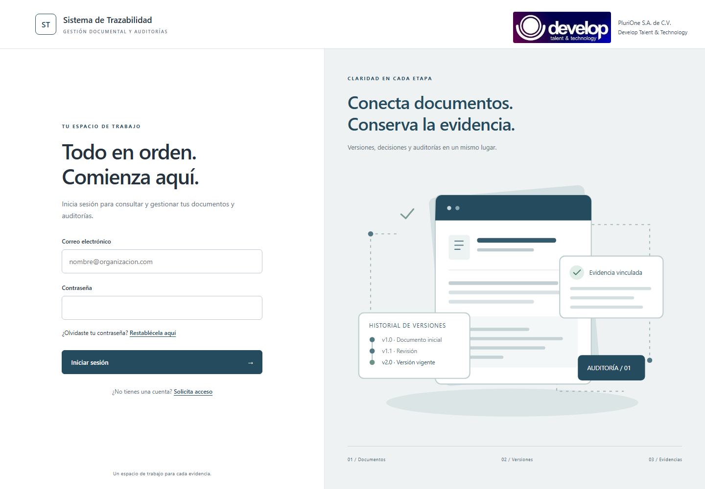
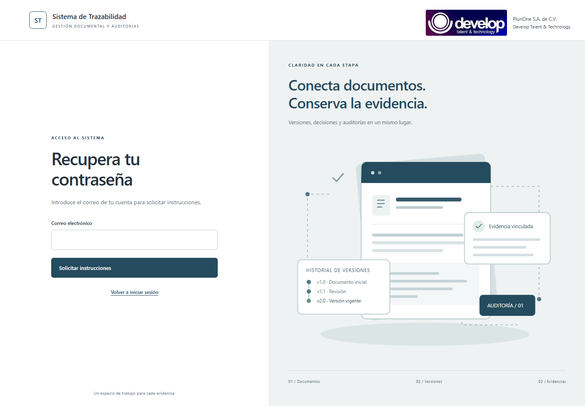
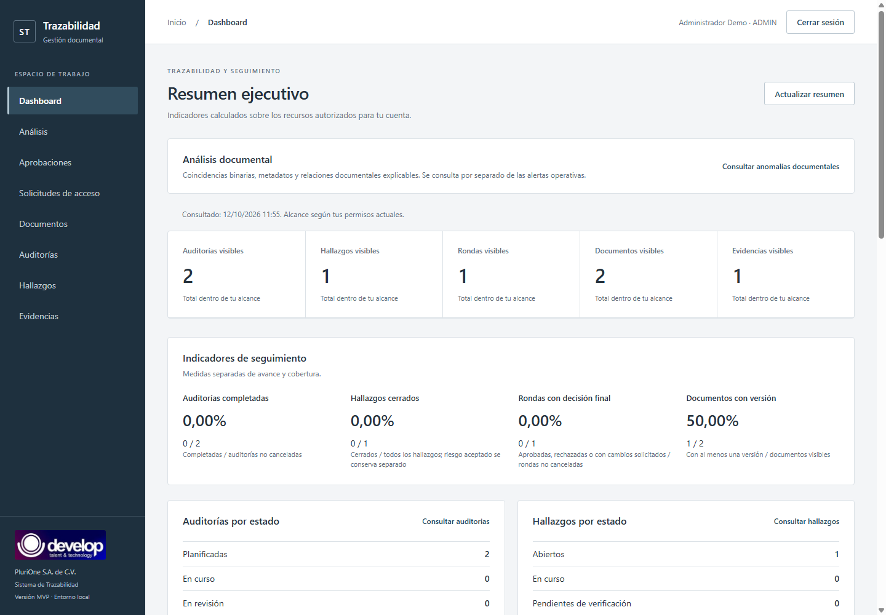
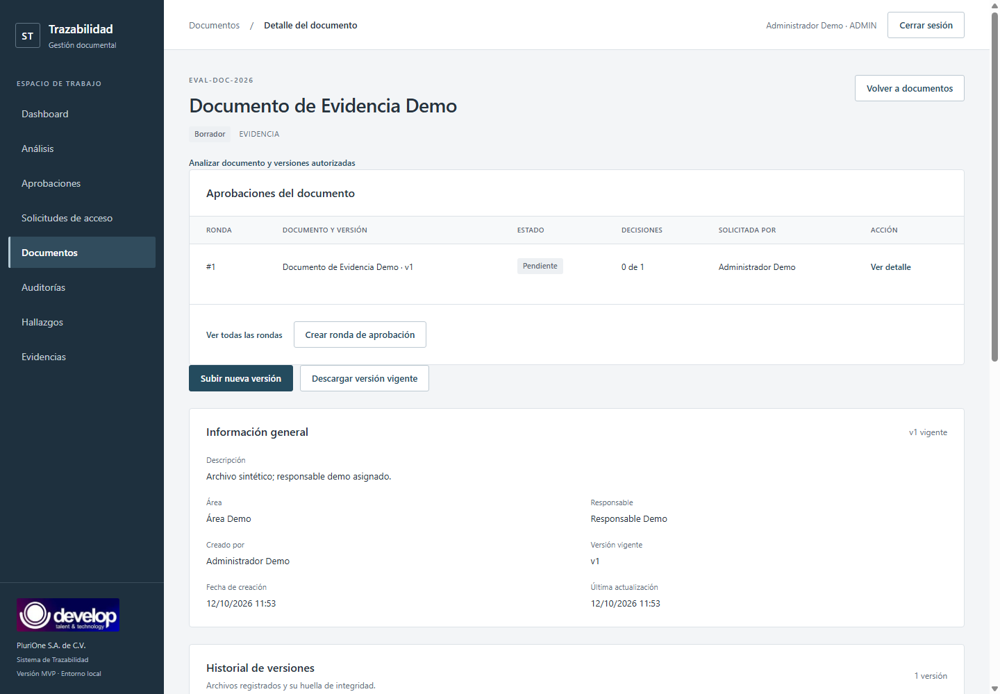
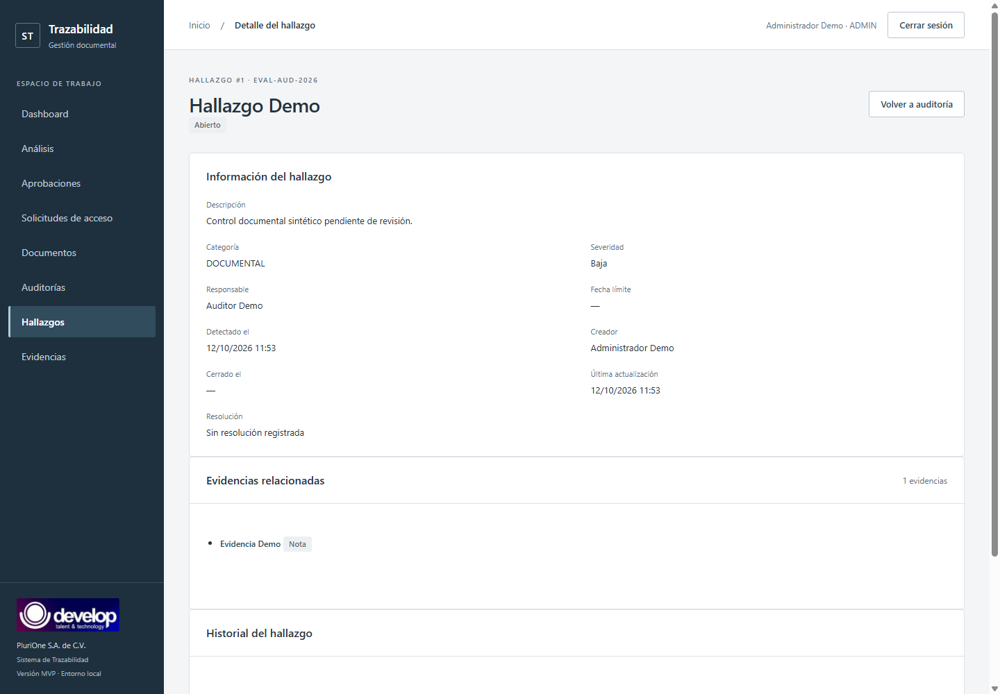
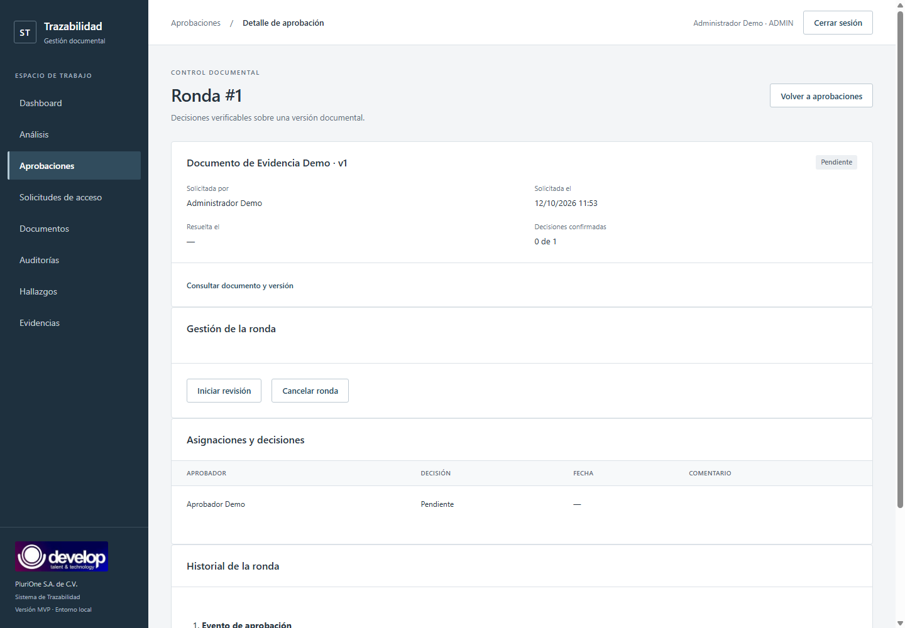
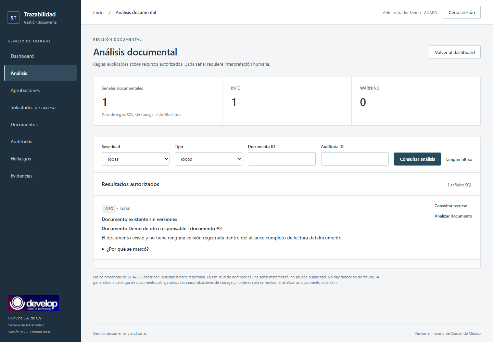
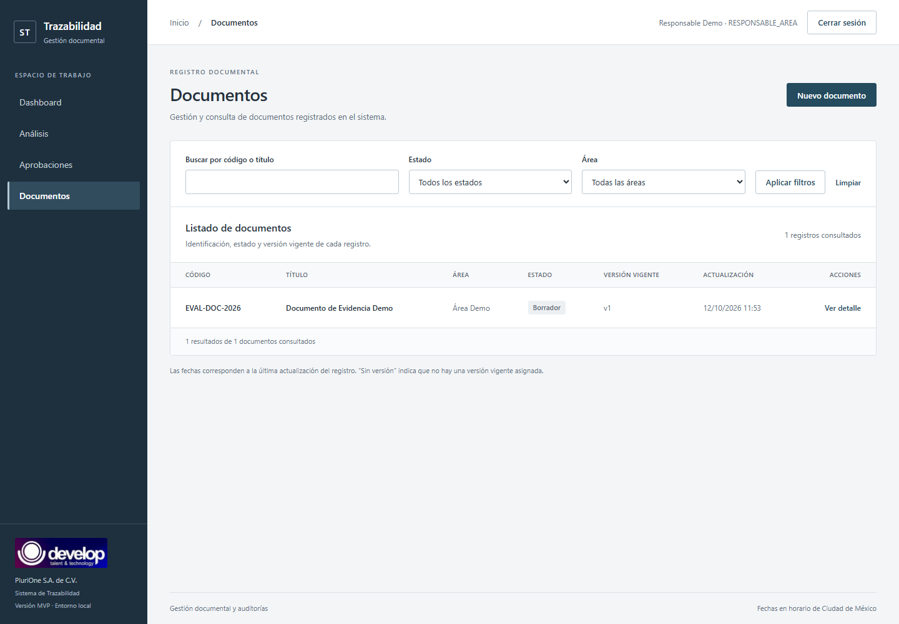

# Manual de usuario

Sistema de Trazabilidad Documental para Auditorías. Recorrido de evaluación local con datos sintéticos.

Capturas renovadas el 12 de octubre de 2026 con identidad Develop / PluriOne. El branding no cambia la navegación ni los procedimientos descritos.

## 1. Entrar al sistema

Abra http://127.0.0.1:8080. Escriba el correo y la contraseña proporcionados por el administrador. Las cuentas de evaluación se reciben por separado en el documento privado `01_ACCESOS_PRUEBA.md` de TODO Academy; [Accesos de prueba](ACCESOS_PRUEBA.md) contiene sólo instrucciones públicas; funcionan después de la instalación y seed. No use sus contraseñas en otros servicios.

Si la combinación no se admite, revise los datos. En la demo, consulte el archivo privado de TODO Academy o al operador; estas identidades no reciben correo de recuperación. Tras varios intentos puede requerirse esperar; si el operador habilitó verificación adicional, complete el desafío mostrado. Un servicio temporalmente ocupado requiere esperar y reintentar sin repetir operaciones a ciegas.

## 2. Recuperar contraseña o solicitar acceso

**No disponible en la demo:** no se configuró un proveedor SMTP externo y las cuentas ficticias de evaluación no tienen buzón. Están implementados el backend de solicitud, tokens y controles de seguridad, cola, worker y configuración SMTP; las pruebas con transporte sustituido no demuestran correo real recibido.

En una instalación con SMTP operativo, worker y un buzón autorizado, use Recuperar contraseña en el login y escriba su correo. La respuesta no revela si existe una cuenta. Si corresponde, recibirá un enlace temporal de un solo uso. Abra el correo, escriba una nueva contraseña de al menos 12 caracteres y vuelva a entrar. Un enlace inválido/vencido requiere solicitar otro.

Solicitar acceso permite enviar nombre, correo y motivo. No crea una cuenta automáticamente. ADMIN revisa y aprueba o rechaza. Si aprueba y el correo funciona, el enlace inicial permite establecer contraseña; sólo entonces la cuenta queda creada/activa. No se elige un rol administrativo desde el formulario público.

## 3. Navegación según rol

La barra lateral muestra sus módulos disponibles. Dashboard resume su alcance; Documentos permite trabajar con lo que tiene autorizado; Aprobaciones presenta sus rondas. ADMIN ve además auditorías, hallazgos, evidencias y solicitudes de acceso. RESPONSABLE_AREA no ve estos módulos y no puede entrar escribiendo una dirección manualmente.

| Rol | Trabajo disponible |
|---|---|
| ADMIN | Explorar globalmente, gestionar auditorías/hallazgos/rondas y revisar solicitudes |
| AUDITOR_INTERNO | Auditar su expediente, registrar hallazgos/evidencias y gestionar rondas autorizadas |
| AUDITOR_EXTERNO | Consultar sus auditorías y registrar evidencias, sin gestión de hallazgos/rondas |
| RESPONSABLE_AREA | Crear y cargar documentos propios; consultar sus rondas/indicadores/análisis |
| APROBADOR | Revisar versiones asignadas y emitir su decisión pendiente |

## 4. Dashboard y alertas

Al entrar verá indicadores de documentos y operaciones autorizadas. Las tarjetas y los enlaces conducen a recursos de su alcance. Las alertas describen condiciones pendientes al consultar el dashboard; no se envían automáticamente por correo. Si el sistema informa «sin datos» o «no disponible», no lo interprete como un resultado favorable de auditoría.

## 5. Auditorías

Disponible para ADMIN y auditores según alcance. Busque por código/nombre y filtre por estado. Abra la ficha para revisar responsable y expediente. ADMIN y AUDITOR_INTERNO pueden crear; este último se asigna a sí mismo. El responsable debe ser auditor elegible. Sólo ADMIN dispone de edición y avance de ciclo actuales: planificada, en progreso, en revisión y completada. Cerrar exige que el expediente cumpla las condiciones mostradas.

Si otra persona cambió el recurso, recargue la ficha antes de repetir. No hay botón actual de cancelación de auditoría, aunque puedan existir registros con ese estado. La asociación inicial documento–auditoría de la demo está preparada por instalación; no se ofrece un formulario general para crear ese vínculo en esta versión.

## 6. Documentos y versiones

Abra Documentos, busque por código/título y filtre estado/área. ADMIN puede ver el conjunto; RESPONSABLE_AREA sólo sus documentos; auditores y aprobadores tienen alcances específicos. Nuevo documento crea una cabecera con código, título, tipo, área y estado. El usuario responsable de área queda como propietario y no puede reasignarse a otra persona.

La ficha ofrece Subir nueva versión y Descargar versión autorizada. Seleccione archivo y comentario de cambio. Se conserva cada versión previa; la huella SHA-256 identifica los bytes registrados. El tamaño permitido aparece en pantalla y depende de los límites del servidor. Un archivo no se publica en un enlace directo público.

Los documentos propios no conceden permiso para ver la auditoría a la que se relacionan. El historial administrativo de eventos no está disponible para todos los roles, aunque puedan consultar versiones autorizadas.

## 7. Hallazgos y evidencias

ADMIN y auditores autorizados consultan hallazgos. ADMIN/AUDITOR_INTERNO crean y editan dentro de su alcance, seleccionando severidad, categoría, responsable y fecha cuando corresponda. Registre una descripción concreta y sustente con evidencia.

Desde la ficha puede consultar evidencia asociada; los roles autorizados registran archivo o evidencia lógica. Una nota describe el soporte; una referencia conserva su URL; un archivo tiene hash y tamaño. No elija una versión ajena al expediente. El hallazgo avanza desde abierto a progreso, verificación y cierre, o aceptación de riesgo según reglas. El cierre requiere resolución y datos válidos. RESPONSABLE_AREA no tiene acceso al módulo.

## 8. Aprobaciones

La aprobación revisa una versión concreta, no cualquier archivo de la cabecera. ADMIN/AUDITOR_INTERNO autorizado crea la ronda, elige aprobadores elegibles e inicia revisión. APROBADOR entra a sus asignaciones y decide aprobar, rechazar o solicitar cambios con comentario según contrato. Una decisión emitida no se reemplaza. El resultado de la ronda se determina cuando sus decisiones están completas.

ADMIN gestiona rondas y consulta resultados, pero no puede decidir en nombre del APROBADOR. Para demostrarlo en la demo, inicie la ronda como ADMIN y entre con la cuenta APROBADOR del archivo privado de TODO Academy. Si la ronda es terminal o aparece conflicto, revise su estado; no intente editar registros históricos.

## 9. Análisis documental

Abra Análisis para consultar anomalías dentro de su alcance. Use filtros y el detalle de «por qué se marcó» para entender la regla/evidencia. Hay comparación de hashes, reglas de metadatos/versiones y similitud heurística de nombres; los chequeos locales pueden tener límites y truncación. No garantizan detectar cualquier irregularidad ni todos los documentos faltantes y no equivalen a una certificación ni a un juicio automático del auditor. El motor es determinista y explicable: no analiza semánticamente el contenido ni utiliza Ollama, IA generativa, LLM, machine learning o modelos entrenados.

## 10. Evaluar la vista restringida

Cierre sesión ADMIN y entre como RESPONSABLE_AREA. Documentos muestra sólo Documento de Evidencia Demo; Documento Demo de otro responsable queda oculto. La barra lateral carece de administración global. Puede cargar una versión propia y consultar sus aprobaciones/análisis. Intentar entrar a Auditorías escribiendo su dirección debe ser rechazado por el sistema.

## 11. Salir y resolver incidencias

Use Cerrar sesión; no basta cerrar una pestaña. La sesión caduca y puede exigir login nuevamente. Si no se confirma la revocación remota, la interfaz informa el problema mientras limpia la sesión local.

Ante recurso no disponible revise alcance con ADMIN, sin pedir passwords de otras personas. Ante error de carga consulte listado antes de reenviar. No comparta tokens, enlaces de recuperación ni capturas con información real. El operador puede configurar SMTP para una instalación con buzones autorizados; las identidades ficticias de evaluación seguirán sin recibir correo.
